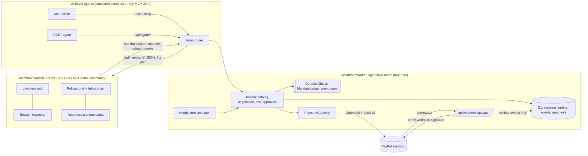
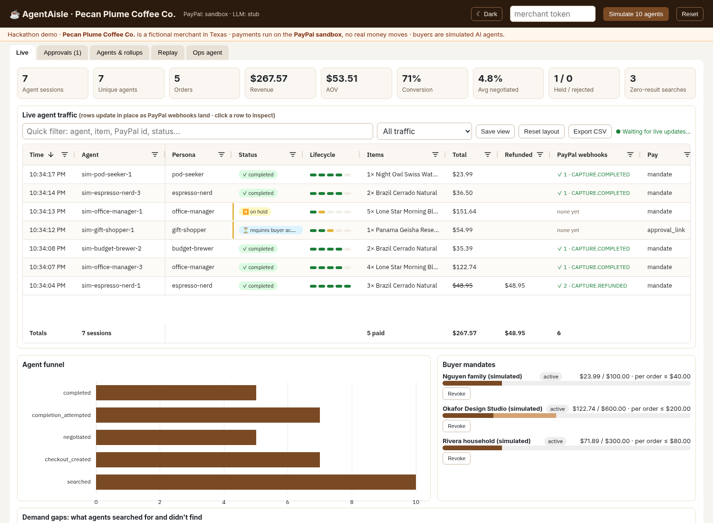

# AgentAisle

An agent-ready storefront for small merchants. AI buyer agents discover products, negotiate within merchant rules and pay with **PayPal**, either through a saved-PayPal mandate (Vault) or by approving each order. The merchant watches the agent traffic live and approves anything risky.

Demo merchant: **Pecan Plume Coffee Co.**, a fictional Texas coffee roaster. All data is made up.

> Status: live public demo at https://agentaisle-demo.kamalkatul92-kk.workers.dev (PayPal **sandbox** only, no real money; fictional merchant in Texas). Local dev still runs fully offline against a mock PayPal adapter and a deterministic LLM stub, with no keys needed.

**Links**
- Source: https://github.com/kamalkatul92kk-sudo/agentaisle
- Live demo (read-only, PayPal sandbox): https://agentaisle-demo.kamalkatul92-kk.workers.dev
- Demo video (under 3 minutes): https://youtu.be/0LZBDRTz6PQ · cover: [`submission/video/cover.png`](submission/video/cover.png)
- Devpost write-up: [`submission/writeup.md`](submission/writeup.md) · judge testing steps: [Testing instructions for judges](submission/writeup.md#testing-instructions-for-judges)
- Video script: [`submission/video-script.md`](submission/video-script.md) · screenshots: [`submission/screenshots/`](submission/screenshots/)

## Architecture



- **Cloudflare Worker** (Hono), with **D1** for the catalog, sessions, orders, events and approvals, and a **Durable Object** (`MandateLedger`) for spend caps that are strongly consistent per mandate.
- **MCP server** at `POST /mcp` (stateless streamable HTTP). It exposes these tools: `search_catalog`, `get_product`, `store_policies`, `create_checkout`, `update_checkout`, `negotiate`, `complete_checkout`, `get_checkout` and `cancel_checkout`.
- **REST checkout API** that mirrors MCP under `/api/agent/*`.
- **PayPal Orders v2 + Vault v3** behind the `PaymentGateway` interface:
  - `paypalMock.ts` for tests and dev
  - `paypalRest.ts` for the sandbox
- **Webhooks:** `POST /api/webhooks/paypal`. Deduped. Handles order approved and completed, refunds, and vault token deletion, which revokes the mandate.
- **Risk and approval queue:**
  - velocity, new-agent and basket checks
  - floor prices
  - mandate per-order and monthly caps, plus category limits
  - the ops agent only *proposes* actions, and a human approves them
- **Traffic simulator:** seeded buyer-agent personas (bargain hunters, forgers, injectors and others) driven by `POST /api/merchant/simulate` and a cron.
- **Merchant console** (`web/`): React + Vite, AG Grid/Charts Community widgets (details below). An optional AG Studio tab is off in the public build. See [docs/ag-studio-integration.md](docs/ag-studio-integration.md).
- **LLM:** the `LlmClient` interface. `LLM_MODE=stub` (default) is deterministic. The optional OpenAI-compatible client is used only when `LLM_MODE=openai` and a key are set. LLM output never sets prices or links.

## Merchant console: AG Grid features

Everything in the public demo uses **AG Grid Community 36 and AG Charts Community 14 (MIT)**. No Enterprise modules are used, and a test (`test/gridLogic.test.ts`) fails if one is added.

**Live desk** (`web/src/widgets/LiveDesk.tsx`)
- Live in-place updates: the page polls every 3 s, diffs the rows (`grid/logic.ts`, unit-tested) and applies only the changes with `applyTransactionAsync`. Rows keep their position, sort, filter and selection, and changed cells flash.
- Custom cell renderers (`widgets/renderers.tsx`):
  - status pills;
  - a 5-step payment lifecycle bar (checkout, PayPal order, capture, verified webhook, refund);
  - a PayPal ID cell with a copy button;
  - a verified-webhook badge;
  - struck-through totals for fully refunded orders.
- A row flashes when a signed PayPal webhook lands. Rows that need attention get a marker.
- Toolbar:
  - quick filter (searches agent, item, PayPal order or capture ID, status);
  - preset views via an external filter: Needs attention, Refunds, Webhook-verified, High value, External agents;
  - **saved views** in localStorage, which store column state, filter model, quick filter and preset;
  - Reset layout and Export CSV.
- Pinned Time and Agent columns, plus a pinned **Totals** row that follows the current filter. Its Total is the gross of paid sessions and matches the Revenue KPI.
- **Session inspector:** click a row to open a lifecycle stepper, the PayPal IDs and a nested grid of that session's event log. Verified webhook events are highlighted.

**Rollups** (`web/src/widgets/Rollup.tsx`)
- Group sessions by persona, agent, platform, status or payment mode. Grouping is computed in `grid/logic.ts`, because Community has no row grouping.
- Columns: conversion and refund-rate bars, AOV, and an SVG revenue-trend sparkline per group.
- A linked **AG Charts** bar chart (revenue vs refunds) follows the grid's current filter and sort.

**Theming:** Theming API (`themeQuartz` + warm colour schemes with brand params) with a persisted light/dark toggle. Charts switch themes with the grid.

**AG Studio (optional, not in the public build):** `web/src/studio/` holds an AG Studio report over the same data. AG Studio is commercial software, so it is built only with `VITE_ENABLE_AG_STUDIO=true` plus a licence key in `VITE_AG_STUDIO_LICENSE_KEY` (e.g. the 45-day trial). The default build contains no `ag-studio` code.

## Screenshots

Captured from the live sandbox demo on Oct 28, 2026, saved in `submission/screenshots/`:

1. [`01-live-desk.png`](submission/screenshots/01-live-desk.png): Live desk with lifecycle, webhook badges, a refunded row and the pinned totals.
2. [`02-session-inspector.png`](submission/screenshots/02-session-inspector.png): the inspector for a refunded session, showing the event log with both verified PayPal webhooks.
3. [`03-rollups-light.png`](submission/screenshots/03-rollups-light.png): rollups by persona with ratio bars, sparklines and the linked chart.
4. [`04-rollups-dark.png`](submission/screenshots/04-rollups-dark.png): the same in dark mode.



Older console shots are in `docs/screenshots/`.

## Quick start

```bash
npm install && npm --prefix web install
cp .env.example .dev.vars        # edit MERCHANT_TOKEN etc.; .dev.vars is gitignored
npm run migrate:local
npm run build:web
npm run dev                      # http://127.0.0.1:8787  (paste MERCHANT_TOKEN in the console)
npm run smoke                    # end-to-end check against wrangler dev
```

## Tests

```bash
npm test          # vitest, 85 tests: unit, MCP contract, HTTP, PayPal REST (fake server), 13 agent-safety scenarios
npm run typecheck
```

## PayPal sandbox go/no-go (vaulted payments)

```bash
export PAYPAL_CLIENT_ID=... PAYPAL_CLIENT_SECRET=...     # sandbox app; never commit
npm run gonogo            # path A: setup-token -> buyer approves -> payment token -> buyer-absent charge
npm run gonogo:path-b     # path B: store_in_vault ON_SUCCESS on the first order
npm run fallback          # per-order approval flow (no vault)
npm run gonogo:fake && npm run fallback:fake   # dry runs against the in-process fake
```

The scripts refuse to run unless the base URL is `*.sandbox.paypal.com`. They print the buyer approval URL, then poll. Reports are written to `reports/`, which is gitignored.

If the buyer does not approve before `--timeout-min` (default 10), the verdict is `PENDING_BUYER_APPROVAL` (exit code 3), not NO-GO. Approve the printed URL as the sandbox buyer whenever you like, then resume without creating new PayPal objects:

```bash
npm run gonogo -- --setup-token=<setup token id>       # path A
npm run gonogo:path-b -- --order-id=<order #1 id>      # path B
npm run fallback -- --order-id=<order id>              # per-order approval
npm run probe:sandbox                                  # buyer-free checks of the REST adapter against the real sandbox
```

## Public demo deploy (Cloudflare free plan)

The `demo` wrangler env deploys Worker `agentaisle-demo` to workers.dev with D1 `agentaisle-demo`, a SQLite-backed Durable Object, and an hourly simulator cron. `DEMO_MODE=true` makes the control room readable by anyone; every action (simulate, approve, refund, reset) still needs the merchant token.

```bash
npm run migrate:demo        # wrangler d1 migrations apply agentaisle-demo --remote --env demo
npm run deploy:demo         # build web + wrangler deploy --env demo
# secrets, piped from env so they are never echoed or written to disk:
printf %s "$PAYPAL_CLIENT_ID" | npx wrangler secret put PAYPAL_CLIENT_ID --env demo
#   ...same for PAYPAL_CLIENT_SECRET, MERCHANT_TOKEN, SIM_VAULT_ID, PAYPAL_WEBHOOK_ID
node scripts/verify-grid-vs-paypal.mjs https://agentaisle-demo.kamalkatul92-kk.workers.dev   # grid vs PayPal sandbox
```

The PayPal sandbox webhook points at `/api/webhooks/paypal` for CHECKOUT.ORDER.APPROVED/COMPLETED, PAYMENT.CAPTURE.COMPLETED/REFUNDED and VAULT.PAYMENT-TOKEN.CREATED/DELETED. Every event is checked with `/v1/notifications/verify-webhook-signature`, using the raw body spliced in verbatim, before anything is stored. Unsigned or forged events get a 401 and never reach D1.

## Security

- No secrets live in the repo. `.env.example` lists every variable.
- Mandate tokens are stored only as hashes, and sessions are scoped per agent (other agents get 404).
- Payments are idempotent, keyed per agent and checkout.

## License

MIT © 2026 Kamal Katul. See [LICENSE](LICENSE).
